# ScottyGo features and current screens

ScottyGo combines Pittsburgh Regional Transit (PRT) buses and CMU shuttles in one map. The current personal deployment is [scottygo-ningrui.onrender.com](https://scottygo-ningrui.onrender.com/). This guide describes the implemented app; [ARCHITECTURE.md](ARCHITECTURE.md) covers development and operations, and [API.md](API.md) describes its interfaces.

## Use cases and acceptance flows

These flows start from baseline **e06755c** and are updated with each accepted iteration below. Each main flow has an ID ending in **-M**; alternate and error flows use **-A1**, **-A2**, and so on. Keep these IDs when extending a flow. Bold text matches a visible control or its accessible name. A route, bus or platform number is sample data: substitute an available record and record its ID in the evidence.

Unless stated otherwise, the actor is a signed-in rider with an active account that has accepted the terms. Start map journeys from **Map** with the tour closed. For every step, check the stated result before continuing. For every cancellation, verify that no pending response reopens the dismissed interface. Use disposable accounts and isolated data for registration, account changes, subscriptions and reports.

### Evidence and execution rules

| Method | What it establishes |
| --- | --- |
| Hosted | Actual deployed pages and available provider data. Record deployment revision, time, route/stop/bus IDs, actions and observed outcomes. An empty live feed establishes the empty path only. |
| Browser fixture | Actual built pages and controllers, exercised in phone-sized WebKit and desktop Chrome with controlled GPS, Maps, feeds, sessions and network replies. Record which dependencies were simulated. |
| Deterministic | A named test and its passing assertions establish the specific alternate conditions they exercise. A passing suite alone does not establish every substep in a branch. |
| Database | Isolated loopback MongoDB workflows establish persistence, authorization and concurrent writes for disposable accounts. They do not submit test reports to production riders. |
| Native logic | iOS host navigation and recovery policy tests establish their decisions for supplied inputs. |
| Physical iPhone | Safari/Chrome permission prompts, real GPS/walking, software keyboard, VoiceOver, rotation with browser bars, native launch, OS links/share sheet and background recovery require a device. These remain **pending until a device result is recorded**. A phone-sized WebKit pass does not mark them complete. |

Before each iteration, rehearse all main flows on the preceding accepted release and run the mapped alternate checks. Record per-flow pass, fail, unavailable test condition or device pending; retain the exact assertions and observations. After implementing a round, repeat affected flows and the cumulative phone/desktop walkthrough before release. The sections below prescribe checks; they are not a claim that this new iteration has already passed them. Test implementations live in tests/client.tests, tests/server.tests, ios/mobile/tests and tools/rider-rehearsal.

### Flow index

| ID | Actor and goal | Entry |
| --- | --- | --- |
| UC01 | New rider creates an account | Sign in → Create an account |
| UC02 | Rider signs in or out | Sign in / navigation menu |
| UC03 | Rider learns map symbols and controls | Map key / first-use tour |
| UC04 | Rider chooses a trip origin | Location control / empty search field |
| UC05 | Rider changes map scope and appearance | Map filter buttons / Map appearance |
| UC06 | Rider chooses an overlapping map object | Map tap |
| UC07 | Rider searches for a route or platform | Search routes or stops |
| UC08 | Rider compares boarding locations | Near me → Nearby stops |
| UC09 | Rider explores a route and transfers | Explore route |
| UC10 | Waiting rider compares departures | Selected stop card |
| UC11 | Rider locates and follows a bus | Bus marker / route Buses tab |
| UC12 | Rider walks to a selected stop | Directions |
| UC13 | Rider keeps and reopens personal shortcuts | My places |
| UC14 | Rider shares or resumes a public map view | Share map view / Share stop |
| UC15 | Rider follows route updates | Saved routes / map bell |
| UC16 | Rider reads relevant notices | Alerts → Transit updates |
| UC17 | Rider receives a foreground live report | An open signed-in page |
| UC18 | Rider reports bus conditions | Bus card → Report |
| UC19 | Rider maintains their account; administrator manages access | Account / Manage Accounts |
| UC20 | Rider opens the iOS wrapper; operator checks service health | Native app; separate dashboard flow |

### UC01 — Create an account

**Actor and preconditions.** A signed-out rider has a unique username, eligible CMU email and password. Use a disposable identity in a fixture or isolated database when completing registration.

**UC01-M**

1. Open Sign in and tap **Create an account**. The registration form shows Username, Email, Password and Confirm Password.
2. Enter valid values and wait for validation hints. Enter the same password twice and check **Agree to Terms of Service**. **Register** becomes enabled only when every required field and agreement is valid.
3. Tap **Register**. **Review your account** shows the submitted username and campus email, without displaying the password.
4. Tap **Confirm** once. Successful creation, agreement and login show **Registered successfully. Redirecting...**, then open the map or the public map target carried through sign-in.

**Alternate flows.**

- **UC01-A1 — Correct fields.** Enter a short/reserved username, non-CMU email, invalid password or mismatched confirmation. Observe the field error and disabled Register; correct it and wait for validation. **Use @andrew.cmu.edu** completes a bare email name. **Continue with …** focuses the first incomplete field. **Show/Hide** changes password visibility; leaving the page or hiding it masks revealed fields.
- **UC01-A2 — Read or revise without creating.** Tap **Terms of Service**, then **Back to registration**. The draft remains and reading alone does not check agreement. From the review dialog choose **Edit details** to return to the populated form. **Back to Login** leaves registration without submitting it.
- **UC01-A3 — Recover a failed submission.** Submit an existing username or simulate a failed validation/registration request. Read the inline error and retry after correction. If creation succeeds but agreement/login fails, follow the displayed error and use Login with the created account; the pending-agreement flow is UC02-A3. Do not assume a partial failure rolled back account creation.

**Finish/cancel.** Success creates an agreed account and authenticated session. Previewing terms or cancelling review creates nothing. **Test method.** Browser fixture for the complete form and review; auth-validation and register unit checks for validation; register integration for creation/duplicates/agreement persistence. Hosted preview may stop before Confirm. Physical keyboard/autofill is pending device evidence.

### UC02 — Sign in, resume and sign out

**Actor and preconditions.** A registered rider knows their credentials. The normal account is Active and agreed.

**UC02-M**

1. Open Sign in, enter **Username** and **Password**, then tap **Login**. Observe successful login and map loading.
2. Open **Open navigation menu**. Use **Saved routes**, **Alerts** or **Account**, then **Map**; verify the destination title and return to the rider's map state.
3. Open the menu and choose **Log out**. The local session is cleared and Sign in appears. A protected page requires authentication again.

**Alternate flows.**

- **UC02-A1 — Resume a public target.** Open a valid public route/stop link while signed out, complete Login, then verify the same target opens. Only the sanitized public map state is carried through the handoff.
- **UC02-A2 — Invalid or blocked login.** Submit empty fields, wrong credentials, an Inactive account or enough controlled failed attempts to trigger throttling. The error remains on Sign in, no session is granted, and the form becomes usable again. Inactive-account guidance directs the rider to an administrator.
- **UC02-A3 — Pending agreement.** Log in with an account that has not agreed. The terms dialog offers **Accept** and **Decline**. Accept saves agreement and obtains a fresh session; Decline → **OK** returns to Login without access. These actions belong to pending agreement, not the read-only registration terms preview.
- **UC02-A4 — Session changes.** Expire/revoke the token or change accounts. Protected requests must reject the old session. Re-login restores permitted access; account-scoped shortcuts and read states must belong to the newly signed-in account. Route mute preferences currently belong to the browser, as described in UC15-A2.

**Finish/cancel.** Logout ends local access; abandoning Login leaves the rider signed out. **Test method.** Browser fixture login/navigation/logout and link handoff; auth-map-handoff, loginlogout and auth-rate-limit tests; isolated database for login/revocation, account-switch checks for local data.

### UC03 — Learn the map

**Actor and preconditions.** A rider has a ready map. A new account may receive the first-use tour.

**UC03-M**

1. Open **Map key**. **Reading the map** identifies Reported bus, Estimated movement, Delayed location, Bus stop, Your location, Planning location and Routes & detours.
2. Tap **Take the map tour**. The guide highlights an available control and names its action.
3. Use **Next** until the final step, then **Finish**. The guide closes and focus returns to its opener.

**Alternate flows.**

- **UC03-A1 — Skip and replay.** Choose **End tour** or Escape. The tour closes; reopen it from Map key. First-use completion is recorded for that account when the guide finishes or ends.
- **UC03-A2 — Explore nonlinearly.** Select a **Jump to topic** entry, use **Back**, and resize/rotate. The correct control is highlighted, the card stays within the viewport and focused controls remain usable. Close Map key with an outside tap or Escape.

**Finish/cancel.** Ending the guide leaves the map available and changes no map selection. **Test method.** Browser fixture/Hosted replay; map-guide-flow, map-key and feedback tests. VoiceOver, touch rotation and real browser-bar movement require device evidence.

### UC04 — Choose where the trip starts

**Actor and preconditions.** A rider has the map open. GPS permission and a planned starting point are separate states.

**UC04-M**

1. Tap the map's location control and allow geolocation when prompted. A blue location marker appears when a fix arrives.
2. Pan away, then tap the location control again. The map recenters and zooms to the current position.
3. Focus the empty **Search routes or stops** field to open **Starting point**. **Current Location** reports **Using GPS** when GPS is available; choose it to use GPS as the planning origin.

**Alternate flows.**

- **UC04-A1 — GPS fails or recovers.** Deny permission, simulate timeout/unavailable service, or remove an earlier permission. Read the location feedback, retry with its available action/location control, allow permission in browser and device settings, then retry. A new valid fix replaces the fallback and enables GPS-dependent actions. An unsupported browser has no retryable GPS implementation.
- **UC04-A2 — Plan elsewhere.** In Starting point choose **Set a different location**, search **Search for a location**, and choose a Places result. Alternatively choose **Use CMU campus** or **Use map center**. The planned marker, current-start label, Nearby and Directions use the chosen point. Map center uses the position at selection time.
- **UC04-A3 — Start at a saved platform or return to GPS.** With a saved stop, choose it under **Start at a saved stop**, then **Use stop**. Reopen Starting point to confirm it. Choose **Current Location** to return to GPS, retrying permission if needed. A chosen place never grants GPS report eligibility.

**Finish/cancel.** **Close starting points**, Escape or an outside tap dismisses the picker without choosing a new origin. **Test method.** Browser fixture allowed/denied/recovered positions and all origin choices; map-location-recovery, location-search-recovery and geolocation-controller tests. Actual iOS permission recovery and accuracy remain device checks.

### UC05 — Set map scope and appearance

**Actor and preconditions.** A rider has a loaded route catalog. Scope filters affect ScottyGo service objects; appearance controls affect the base map beneath them.

**UC05-M**

1. Tap **Filter routes**. In **Choose a route**, type a route number/name, select its row, then **Show route**. The chosen route's line, stops and buses are shown according to enabled systems/directions.
2. Open **Filter transit systems**, change the PRT/CMU switches and tap **Apply**. Open **Filter route directions**, change **Show Inbound/Show Outbound**, then Apply. Confirm the visible service matches the committed settings.
3. Tap **Clear all filters**. The normal unfiltered map scope returns; a later route choice remains available.

**Alternate flows.**

- **UC05-A1 — Stage or cancel a route.** Search by published name, change **List order**, select a route and choose **Cancel** or close. The committed route stays unchanged. **All routes** → **Show all routes** applies the broad scope. An exact/unique search plus Enter, or a **Recent** route button, applies that choice directly. An ordinary delayed map refresh must preserve an open filter draft.
- **UC05-A2 — Read service context.** Select a route line or its overlap choice to open route information. Read operating days, direction/headsign and first/last trip, notices and detours when supplied. Test one-direction service and absent schedule data. Existing public links may restore date/time filters; the current toolbar has no date/time picker. Clear filters removes that restored restriction.
- **UC05-A3 — Change appearance immediately.** Open **Map appearance**. Select **Streets** or **Satellite with street names**, then a named **Map overlay**. Both remain combined. On Streets, toggle **Stronger street labels**. Changes apply immediately; close and reload to verify persistence. **Focus on map** hides search/route tools; **Show map controls** restores them. **Reset appearance** restores Streets, no overlay and ordinary labels. Blocked storage shows the session-only message. Opening a secondary picker from a card/recovery action must reveal its controls.
- **UC05-A4 — Recover startup or missing geometry.** Delay or fail catalog/geometry loading. Observe a loading/unavailable notice without losing map controls. Retry or wait for the announced automatic recovery; the latest committed selection wins over older responses.

**Finish/cancel.** Filter Cancel discards a draft. Closing appearance retains its already-applied choices; appearance is browser-wide cosmetic state. **Test method.** Browser fixture scope, draft, appearance and focus recovery; Hosted route/schedule checks; map-filter-controls, route-control-interactions, transit-startup-recovery, map-appearance/panel and provider tests.

### UC06 — Select the right object at a crowded intersection

**Actor and preconditions.** A rider is looking at an area with at least two selectable objects under one tap; use a controlled overlap when live traffic does not supply it.

**UC06-M**

1. Tap the overlapping location. **Choose on map** lists the eligible buses, stops and routes once each.
2. Identify the platform by its name and public stop number, or identify the bus/route by its supplied label, then select that row.
3. Verify the matching card/route opens and the chosen object is centered or highlighted as appropriate. Selecting a lone object opens it directly.

**Alternate flows.**

- **UC06-A1 — Narrow the choice.** Use **Buses**, **Stops** or **Routes** and **Find a map item** to narrow the list. **Zoom in here** closes choices and enlarges the tapped intersection.
- **UC06-A2 — Change zoom and scope.** Zoom out/in and change the selected route. Ordinary stop density adapts; shared platform records are deduplicated; the selected platform halo remains identifiable and hidden objects are not offered.
- **UC06-A3 — Dismiss.** Choose **Close map choices** or Escape. No new target is selected and focus returns to the available opener.

**Finish/cancel.** The selected target becomes the next journey's entry, or the unchanged map remains after dismissal. **Test method.** Browser fixture collisions and filtering; Hosted actual intersections when present; map-hit-test, map-selection/provider and route-renderer tests. Multi-touch and finger hit accuracy require a device.

### UC07 — Search for a route or stop

**Actor and preconditions.** A rider has a ready map/search service.

**UC07-M**

1. Type part of a name or number into **Search routes or stops**. Results show matching routes and platforms with highlighted text and distinguishing IDs.
2. If results are mixed, choose **Routes** or **Stops**. Refine the text; the chosen scope remains active.
3. Select a result. The results close and its route or stop opens on the map.

**Alternate flows.**

- **UC07-A1 — Resolve similar results.** Search an exact public ID and confirm it precedes partial matches. For identical names, compare platform IDs and distance when an origin exists before selecting.
- **UC07-A2 — Use the keyboard or clear.** Use arrow keys and Enter to open the active result. Escape dismisses results. **Clear search** removes the query and resets the result view; focusing an empty query opens Starting point (UC04).
- **UC07-A3 — Handle delayed/empty searches.** Type rapidly with replies arriving out of order; only the newest query's results should be offered. A no-match message permits editing. On a failed lookup choose **Try again**; success replaces the error without reopening a dismissed search.

**Finish/cancel.** Selecting opens one target; dismissal keeps the existing selection. **Test method.** Browser fixture mixed results, exact IDs and selection; Hosted search; transit-search tests for cancellation, response order and failure.

### UC08 — Compare nearby boarding platforms

**Actor and preconditions.** A rider has GPS, a chosen origin or the campus fallback. Nearby walking times are approximate distance-based estimates.

**UC08-M**

1. Tap **Near me** to open **Nearby stops**. Confirm the stated search origin and platform list.
2. Compare each platform's public ID, direction/distance, approximate walk and checked arrival preview. A departure before the walk finishes is identified separately from a later reachable preview.
3. Select the desired stop card. Nearby closes, the map centers on the platform and its arrival card opens.

**Alternate flows.**

- **UC08-A1 — Change the search.** Expand **Search settings**, choose **5 min**, **10 min** or **15 min**, and select all routes or the active route. **Search this area** uses the map center; **Use my starting point** restores the original origin. **Filter nearby stops** matches street, public number or serving route. Verify the summary reflects active settings.
- **UC08-A2 — Compare more and save.** Choose **Check … more stops** to request the next preview batch, up to fifteen checked stops. Set **Order stops → Soonest after walking** and **Connections → Two or more routes**. Verified reachable previews lead unchecked/unavailable entries. Save/unsave with the separate card bookmark control without opening the card. Expand **All … routes** where offered.
- **UC08-A3 — Refresh or recover.** Choose **Refresh arrivals** and inspect its checked time. A valid empty result, unavailable predictions and a partially failed set remain distinct. A failed stop search offers **Try again**; failed previews do not erase usable platforms or appear as live zero-wait arrivals.

**Finish/cancel.** **Close nearby stops** or Escape returns to the map without selecting a platform; close cancels unnecessary ongoing discovery work. **Test method.** Browser fixture at least eight stops, missed/reachable departures, extra batches and save; Hosted available nearby data; nearby-stops-panel and nearby-stop-actions tests.

### UC09 — Explore a route and its connections

**Actor and preconditions.** A rider has selected a route with known stops; the vehicle list may legitimately be empty.

**UC09-M**

1. Tap **Explore route**. Verify the route title and active **Stops** tab.
2. Read the nearest boarding stop, choose a **Stop direction**, then select a named platform. The explorer closes and that stop opens on the map.
3. Reopen Explore route, choose **Buses**, and select a listed bus. Its marker centers and bus card opens. Reopen and choose **Show full route** to fit the currently visible route geometry.

**Alternate flows.**

- **UC09-A1 — Find an interchange.** Use **Search route stops** with a stop number/street or connecting route. Select **Order stops → Nearest first** when an origin exists. Compare **Transfer to …** labels. Default alphabetical order does not represent verified trip stop order.
- **UC09-A2 — Locate a specific vehicle.** In Buses use **Find bus or reported stop**, **Order buses → Closest to start/Newest GPS first**, **Recent GPS only** and **Bus direction**. **Reset bus list** restores the whole eligible list. Recent GPS filters the list without deleting delayed markers from the map.
- **UC09-A3 — Empty or unavailable data.** Open a route/direction with no vehicles or stops, then simulate stop-load failure. The appropriate empty/error state appears; **Retry loading stops** retries. Close while loading or select another route; an old reply must not replace the current route.

**Finish/cancel.** Selection opens one map target. **Close route explorer** or Escape leaves the map as it was. **Test method.** Browser fixture both tabs and navigation; Hosted PRT/CMU when available; route-explorer and renderer tests for filter, distance, cancellation and missing data.

### UC10 — Wait for a departure

**Actor and preconditions.** A rider selects a specific stop with a known ID. Use a populated prediction fixture to exercise comparisons.

**UC10-M**

1. Open the stop from the map, search or Nearby. Confirm its name/ID before reading arrivals.
2. Compare the route and ETA on each departure. Tap individual rows to select the visits to include in walking directions; selected state belongs to each visit.
3. Tap **Refresh arrival times**. Confirm the checked time and updated rows; existing selections survive when their visit identity remains present.

**Alternate flows.**

- **UC10-A1 — Narrow the board.** Expand **Arrivals**, choose **Route**, **Show departures → Next per route/Selected only**, and **Time window → Next 15 minutes/Next 30 minutes/Next hour**. Toggle **Pittsburgh clock time**. Load more rows where offered, use **Clear selection**, and use **Show all departures** to reset a filtered empty view.
- **UC10-A2 — Distinguish repeated and changed visits.** Supply two visits by one bus, select one, then refresh. Only that visit is selected. An identifiable ETA shifting at least two minutes shows its earlier/later revision. An estimate more than a minute in the past reads **Estimate passed** rather than remaining Due.
- **UC10-A3 — Lose and regain the feed.** Start with warming data, a healthy empty response, or a failed/unavailable provider. Warming/failure must not say a healthy **No upcoming arrivals**. If cached rows exist, keep them with absolute Pittsburgh times and unavailable feedback. **Retry arrivals** or a successful poll restores fresh countdowns and preserves valid selections.
- **UC10-A4 — Keep the stop handy.** Minimize and restore the card; its board state survives. **Save stop/Saved** toggles the personal shortcut; **Share stop** opens UC14. Close ends this stop's board.

**Finish/cancel.** A selected departure can continue to Directions (UC12); closing the card ends the comparison. **Test method.** Browser fixture healthy, empty, repeated-vehicle, revised and unavailable boards; Hosted observed arrivals; prediction-requests, prediction-shortcuts, stop-boarding and arrival-identity tests plus provider metadata checks.

### UC11 — Find and follow a bus

**Actor and preconditions.** A rider has an eligible bus marker or a route-explorer bus row. Delayed data may remain visible.

**UC11-M**

1. Tap the bus. The map centers/zooms to it and opens one bus card identified by vehicle and route.
2. Read its GPS age/movement state and supplied direction. Observe the same directional marker moving between accepted fixes; an estimate is identified as estimated.
3. Tap **Follow**. As its displayed position moves the map follows. Tap the **Following** control to stop following.

**Alternate flows.**

- **UC11-A1 — Inspect context.** Expand **Details**. Read supplied route name, speed, measured GPS timestamp and straight-line distance to the reported position; switch **Bus speed unit**. Tap the reported platform when provided, **View this route and its stops**, or **Alerts** to open that context. Missing provider fields stay unreported.
- **UC11-A2 — Pause and resume.** While following, drag the map. The control becomes **Resume follow**; tap it to resume. Minimizing/closing, selecting a different target, starting Directions or hiding the bus ends follow mode.
- **UC11-A3 — Interpret uncertainty.** Replay stopped, delayed, stale, missing, duplicate and correcting fixes, detours, outage/recovery and background resume. Keep one marker per bus, reconcile corrections by the supported smooth movement, and expose estimated/delayed state. When prediction confidence/horizon is exhausted the marker waits for a newer fix rather than moving indefinitely. Reduced-motion preference reduces animation. Delayed reporting disables Report until fresh GPS returns.

**Finish/cancel.** Closing leaves the map; follow ends. **Test method.** Browser fixture follow/details; Hosted live buses and supplied fields; vehicle-motion-replay, vehicle-motion-tracker and vehicle-tracker tests with measured input/output traces. Physical ride accuracy, battery use and background timing remain device observations.

### UC12 — Walk to a platform

**Actor and preconditions.** A rider has an origin and selected stop. Walking routing must be available; selected departures are optional.

**UC12-M**

1. On the stop card optionally select departure rows, then tap **Directions**. A cancellable loading state appears and resolves to the walking path.
2. Read the destination name/stop number, distance, walking duration and Pittsburgh arrival time. Expand **Show details** to read provider-supplied steps and distances.
3. Compare each selected fresh departure with estimated walking arrival. The panel reports a margin, tight connection or that the bus may leave first.
4. Tap **Exit**. The walking path/panel closes and the previous map filters return.

**Alternate flows.**

- **UC12-A1 — Plan or simplify.** Choose a planned origin using UC04 before Directions. **Hide details** collapses the panel, and Show details restores it. If the provider supplies no steps, retain the usable summary/path without inventing instructions.
- **UC12-A2 — Cancel or retry.** Exit during loading; a late routing result must not reopen the path. Fail an initial request, read its feedback, and request Directions again when service returns. Rapid repeat taps must not create duplicate walks.
- **UC12-A3 — Continue walking.** Supply real-position updates along and away from the path. Deviation triggers bounded rerouting; a failed reroute preserves the existing path. A position within the arrival threshold produces arrival feedback and completes the walk. Repeated/background updates must not restore an exited journey.
- **UC12-A4 — Use an old arrival snapshot.** Enter Directions from an unavailable arrival board. Its selected rows show **ET · last known**, without a live countdown or boarding margin. A previously healthy estimate that has passed becomes **Estimate passed**.

**Finish/cancel.** Arrival or Exit ends walking mode and restores the map. **Test method.** Browser fixture walk details/exit and stale rows; Hosted actual Maps walking response; directions-controller, walking-directions.service and directions-restoration tests. Physical walking, GPS deviation and route suitability require device/field verification.

### UC13 — Save and reuse personal shortcuts

**Actor and preconditions.** A rider is signed in and has opened a stop or chosen an origin. Shortcuts are stored locally, separately by immutable account ID.

**UC13-M**

1. Open a stop card and tap **Save stop**. The control changes to Saved. If My places has no saved stops, **Find nearby stops** opens discovery directly; save a platform there to begin the collection.
2. Open **My places → Saved stops**. Find the same platform and select it. Its current transit record/arrival card opens on the map.
3. Reload and reopen My places. The saved platform remains when browser storage is available.

**Alternate flows.**

- **UC13-A1 — Organize saved stops.** Use **Search saved stops** and **Saved stop order → Nearest first**. Open a row's **More** actions, choose **Use as starting point**, set/edit its nickname, **Share**, or remove it. The starting-point action uses the platform coordinates for planning without granting GPS eligibility. Clearing a nickname restores the official name. **Clear stop search** recovers a no-match list.
- **UC13-A2 — Save an origin or map scope.** Under **Places**, enter **Place name** and inspect the proposed location. **Change location** opens a picker for a searched place, campus, map center, an available GPS fix or a saved platform. Choosing or cancelling returns to the same name draft; choosing changes only the proposed save location. Select **Save place** explicitly to persist it. Reopen the saved row to plan there; **More → Find nearby stops** starts discovery from that place. Rename/remove are also under More. Under **Views**, enter **View name** and **Save current view**; change map filters and reopen the saved view to restore route/system/direction. Views exclude GPS and date/time selections.
- **UC13-A3 — Reopen history.** Open routes/stops, then **Recent**. Filter **Recent item type**, reopen an item or **Save stop** on a recent platform. Remove an item or **Clear recent/Clear all recent history**; the clear action clears all recent history even when a type filter is active.
- **UC13-A4 — Respect storage boundaries and recover removal.** Remove a saved stop, place, view or recent item, then tap **Undo** in its confirmation. Restore that item without losing unrelated later edits; the restore is one-use and cannot overwrite a newly saved same-ID item, exceed capacity or cross accounts. Exercise twenty saved stops, eight places, eight views and eight distinct recents. At a save limit show feedback instead of silently dropping a saved item. Corrupt storage is sanitized; blocked writes retain current-page changes. Switch accounts during place selection and confirm that the previous account's draft cannot reopen. A failed/missing stop lookup offers feedback/retry instead of opening an unrelated stop.

**Finish/cancel.** Selecting a shortcut closes My places and applies it. Closing without selecting leaves the map unchanged; already-saved edits remain. **Test method.** Browser fixture save/reopen/manage, Hosted disposable local state; rider-shortcuts and rider-shortcuts-store tests for limits, drafts, lookup races and accounts.

### UC14 — Share and resume a map view

**Actor and preconditions.** A rider has a chosen public map scope or stop. The recipient may be signed out.

**UC14-M**

1. Set the desired route/system/direction filters and tap **Share map view** where Web Share is available, otherwise **Copy view link**. For one platform use its **Share stop** action.
2. Complete sharing/copying and open the resulting URL in a separate session. It contains the public view or stop ID, without the sender's GPS, saved places, token or account details.
3. Complete sign-in if required. The destination map applies the shared state and selects the intended platform when present.

**Alternate flows.**

- **UC14-A1 — Cancel or copy manually.** Cancel the native share sheet; no share is reported as successful. If native sharing is unavailable/fails, use the supported copy path; if clipboard writing fails, the manual-copy UI exposes the public URL for selection and copying.
- **UC14-A2 — Recover a target.** Open an unknown stop or unavailable record and follow the visible error/retry state; normal map access remains. A valid sign-in handoff retains the target instead of opening an old locally saved origin over it.
- **UC14-A3 — Resume navigation.** Select several public map states, use Back/Forward, visit Alerts or Saved routes and return via Map. Confirm the expected committed view, without pending old requests replacing it.

**Finish/cancel.** Cancel leaves the current view. Sharing creates a public URL, not a synchronized personal trip. **Test method.** Browser fixture clipboard, hash/history and sign-in; Hosted public link; copy-view-link, stop-link-navigation and map-auth-return tests. System share completion/cancellation needs physical iPhone evidence.

### UC15 — Follow, mute or remove a route

**Actor and preconditions.** A rider has a signed-in account; persistent subscription changes use disposable data in acceptance.

**UC15-M**

1. Open **Saved routes** from navigation, then **+ Add route**. In **Add a route**, search its number/name and select an unsaved route's add action.
2. Confirm the route appears and the saved count increases. Close the sheet and open **Live map** or **Route updates** from its card.
3. Return to the route on the map. The map bell reflects the saved state and can toggle the subscription.

**Alternate flows.**

- **UC15-A1 — Browse a large list.** Under **Filter and sort routes**, set **Alerts** and **Order**. In Add a route, change **Transit system** and **Hide saved routes**. Search results and counts must reflect these controls.
- **UC15-A2 — Pause or stop updates.** Use the card's **Mute notifications for …** control; the route stays saved and no live popup is shown for it in that browser. Mute preferences currently use one browser-wide list, so another account in the same browser can inherit a route mute. **Unmute notifications for …** resumes it. **Remove … from saved routes** deletes the subscription immediately after successful save and leaves its socket room; removal has no extra confirmation dialog.
- **UC15-A3 — Recover mutation/load failures.** Try a duplicate, an eleventh route, a stale/concurrent add or failed remove. Show the appropriate limit/error and keep the accurate list/count. Use **Try again** for load errors. Failed saves must not leave a permanently optimistic bell/count.

**Finish/cancel.** Closing Add a route discards the sheet search, while completed adds remain. **Test method.** Browser fixture add/mute/remove/filter; subscriptions and map-subscription-session tests; isolated subscription-concurrency persistence checks. Hosted browse may stop before account writes.

### UC16 — Read and act on transit updates

**Actor and preconditions.** A rider opens Alerts; agency notices and recent rider reports are independent sources.

**UC16-M**

1. Choose **Alerts** in navigation. **Transit updates** displays source tabs, counts and current loading/refresh status.
2. Search **Search transit updates** for a relevant route, stop, bus or keyword. Open a notice's detail disclosure when present and read its message, route/platform context and publication window.
3. Follow a public route/platform link to its map, or return to the inbox and choose **Refresh**. Verify the updated status while retaining usable reading context.

**Alternate flows.**

- **UC16-A1 — Limit the inbox.** Combine **All updates/Service alerts/Live updates**, **Saved routes**, **Unread** and More options. Choose **Affected route**, **Agency severity**, **Agency notice window**, **Update topic**, **Order** or **Layout**. Agency windows use Pittsburgh time; unknown dates remain unknown. **Clear filters** restores the broad inbox.
- **UC16-A2 — Open/share context.** Follow a safe linked agency URL or affected platform number supplied by the agency; missing IDs do not invent a platform. **Share** sends/copies a public summary, with manual copy when needed. Cancel leaves the inbox.
- **UC16-A3 — Maintain read state.** **Mark read/Mark unread** changes one card. **Mark shown as read** changes only displayed entries; **Undo mark as read** reverses the last batch. Reload retains account-scoped read state, and materially changed notice content becomes unread again.
- **UC16-A4 — Preserve usable data.** Fail one source or refresh while a detail/link is focused. Usable last data remains with unavailable feedback; it is not presented as a fresh successful empty list. Retry with Refresh. A genuine no-match/empty response explains the active scope.

**Finish/cancel.** Leaving the page retains local read state; cancelling share sends nothing. **Test method.** Browser fixture combined filters/read/link flows; Hosted real notices; notification-rendering, notification-inbox, agency-window and alert-metadata tests. Physical share/VoiceOver requires device evidence.

### UC17 — Receive a live foreground report

**Actor and preconditions.** A signed-in rider has a saved, unmuted route and an open page connected to the update service. Use controlled socket events for repeatable reports.

**UC17-M**

1. Deliver a new report notification for the followed route. A **Live route updates** card appears with route, bus, changed topics, message and age.
2. Choose **View route** or **Read updates**. The corresponding map or filtered history opens.
3. Deliver another event and choose **Dismiss notification**. The card disappears; **Open alert center** provides access to update history.

**Alternate flows.**

- **UC17-A1 — Read without timer loss.** Focus or hover the popup, or hide the document. Its auto-dismiss timer pauses; removing those conditions resumes the remaining time. A link remains actionable while focused.
- **UC17-A2 — Suppress redundant noise.** Mute the route, replay a duplicate event and deliver more events than fit the stack. Muted/duplicate events do not add redundant cards; overflow preserves access to alert history.
- **UC17-A3 — Reconnect or change state.** Disconnect/reconnect the socket and resume the page from history. Active subscriptions rejoin without duplicate stacks. Unsubscribe, mute or end a session; subsequent events must respect the current state. Verify subscription changes in another session separately from browser-local mute preferences.

**Finish/cancel.** Dismissal removes the card, not history. Foreground socket popups do not establish background push support. **Test method.** Browser socket fixture and live-notification-stack/lifecycle tests; real account/event delivery only with deliberate test identities. iOS suspend/resume delivery needs device evidence.

### UC18 — Submit a bus-condition report

**Actor and preconditions.** A signed-in rider has real GPS and a sufficiently fresh bus report. The server validates proximity against a matching vehicle; administrators have a server-side proximity exemption. Use isolated accounts/vehicles for acceptance submissions.

**UC18-M**

1. Open the bus card and tap **Report**. **Bus report** names the bus and route.
2. Answer the **Crowding**, **Priority seats** and **Cleanliness** prompts as known, using **Next**; optionally enter a note under **Comment**.
3. Choose **Review report**. Verify the included answers and use an answer's **Edit** control if needed.
4. Tap **Submit report** once. A successful server response closes the form and shows submission feedback. Eligible changed conditions become rider updates.

**Alternate flows.**

- **UC18-A1 — Revise or abandon a draft.** Use **Report section**, Previous step, **Skip**, or tap a selected option again to clear it. Close a nonempty report; **Keep editing** returns to the draft and **Discard** closes it unsent. Draft retention is within the open form, not a promise of persistence after reload.
- **UC18-A2 — Validate or retry.** Try to review an empty report, exceed the 200-character note limit, or fail submission. Show feedback; no duplicate request is sent while submitting. On failure keep the answers so the rider can edit or retry.
- **UC18-A3 — Reject ineligible location.** Without GPS, Report explains **GPS Required**. A chosen planning origin does not qualify. Delayed bus GPS disables Report; a server-side distant/missing-vehicle validation failure keeps the draft with its error.
- **UC18-A4 — Respect report semantics.** Submit unchanged conditions and a controlled flagged comment. The report can be stored while unchanged fields generate no new update; moderated comment text is excluded from the public notification. **Not Sure** on priority seating contributes no assertion about seat availability.

**Finish/cancel.** Only Submit report sends; Discard sends nothing. **Test method.** Browser fixture full review/cancel/error flow; frontend-accessibility and live-notification unit tests; isolated livenotification integration for submission, moderation and recipients. Actual proximity/GPS needs a physical ride check.

### UC19 — Maintain an account and manage access

**Actor and preconditions.** A signed-in rider can edit their own account. The administrative alternate explicitly requires Administrator, plus disposable target accounts and a second active administrator where needed.

**UC19-M — Rider profile**

1. Open **Account**. Verify the displayed username, email and account status belong to the signed-in account.
2. Choose **Edit**, change the rider's own username or eligible email and wait for validation. Leave password empty to keep it unchanged.
3. Choose **Save Changes**. Observe **Changes saved!**, then reload to verify the saved value and identity continuity.

**Alternate flows.**

- **UC19-A1 — Cancel or correct.** Change a field and choose **Cancel**; the read view returns without saving the draft. Invalid/duplicate values or failed requests show field feedback. Multiple fields save separately; **Some changes saved, but errors remain.** means successful fields are already persisted and the remaining errors need correction.
- **UC19-A2 — Change a password.** Enter a new password and matching **Confirm Password**, then Save Changes. Successful server update revokes prior sessions and requires login with the new password. A blank password does not request a reset.
- **UC19-A3 — Inactivate self.** A non-admin rider changes **Account active** to off. Read the confirmation; **Cancel** keeps the account active, **Confirm** makes it Inactive and signs it out. An administrator must reactivate it. Exercise this only on a disposable account with a recovery administrator.
- **UC19-A4 — Administrator manages another account.** (1) Open **Manage Accounts**, type into **Find an account by username**, select the intended result and verify its identity. (2) Choose Edit. Another user's username/email are not editable; change **Privilege Level**, **Account Status** or reset its password. (3) Save Changes and reload/re-login as the target to verify the specific change. Test denied member access, attempted edits to another user's identity, and last-active-administrator demotion/inactivation rejection. Administrator self-profile editing follows the rider field flow; self-inactivation uses confirmation. Connected account views receive applicable updates; status email delivery is conditional on configured email service.

**Finish/cancel.** Cancel abandons unsaved edits. Completed field writes persist, and password/status changes may end sessions. **Test method.** Browser fixture rider save/cancel and admin controls; manageacct unit/integration and session tests with isolated MongoDB. No production-user mutation is needed for acceptance.

### UC20 — Open the iOS host; separately operate the service

**UC20-M — Rider launches the native wrapper. Actor/preconditions.** A rider has the Expo/native iOS host installed and network access.

1. Open ScottyGo. The host displays **Opening ScottyGo**, then loads the configured production web app inside its safe area.
2. Complete sign-in if required and navigate among Map, Alerts and Account. Same-origin navigation remains inside the host.
3. Return using in-app navigation or the supported iOS Back gesture. The requested page is retained through ordinary host navigation.

**UC20-A1 — Rider navigation/recovery alternatives.** Tap an external HTTP(S) link; the host opens it through the OS. Unsupported schemes and unsolicited external navigation are blocked by policy. On a failed main page, **Couldn’t open ScottyGo → Try again** retries the requested page. A failed map subresource alone must not replace a usable page. Simulate a terminated WebKit content process and foreground return; recover once, then offer explicit retry for repeated termination rather than looping. **Finish/cancel:** close/background the app to leave it; external-link cancellation leaves the app available. **Test method:** native navigation/content-recovery policy tests establish decisions. Actual launch, OS handoff, gestures and foreground recovery remain physical-iPhone checks.

**UC20-A2 — Operator inspects runtime memory. Actor/preconditions.** An operator opens the existing Memory Dashboard with reachable health/sample endpoints. This is an independent operational flow, not a rider-app screen.

1. Open the dashboard and confirm memory metrics, chart and status load from the current service.
2. Change **Sample limit** and **Auto-refresh seconds**, then **Reload now**. Confirm the resulting sample range and that refreshes do not overwrite a newer requested range.
3. Select **RSS max** or **Criticals**. Inspect **Key Data Drilldown**; inspect a chart point where supported.
4. Choose **Download CSV**. Verify its header, row count and sample timestamps against the displayed data. Simulate a failed refresh and confirm its error does not look like a successful new sample. **Finish/cancel:** close the dashboard; it makes no configuration change to transit feeds. **Test method:** Hosted/browser dashboard walkthrough and controlled request-failure/concurrency checks.

**UC20-A3 — Operator checks release and feed readiness.** Fetch /transit/health, confirm the deployed revision, and read each provider's status/freshness plus overall readiness. A successful HTTP status alone does not establish fresh transit data. During warming/outage, observe the map/arrival feedback and recovery after a valid sample; verify PRT and CMU independently. **Test method:** Hosted release check and transit-feed-lifecycle/provider metadata tests. Record actual revision and sample times with each release.

## New explicit-flow iteration series

This is a new ten-round series beyond e06755c. Every round first runs the complete recorded gate with an isolated database: `node tools/rider-rehearsal/round.mjs flow-NN-before --with-db --desktop`. The accepted candidate repeats it under flow-NN-accept. Results list actual browser actions, the exact deterministic assertions for alternate paths, the independent operator flow and physical-device checks still pending. The next round starts after the preceding release is confirmed live.

| Round | Observed starting friction | New rider behavior | Acceptance and release |
| --- | --- | --- | --- |
| 1 · Start a trip from My places | A live phone walkthrough found an empty Saved stops list with no next action. Places could only name the existing CMU origin, and a saved place had no nearby-boarding action. Removing the temporary Campus QA place offered no recovery. | ① Find nearby platforms directly from empty Saved stops. ② Choose a different saved-place location and return to the same name draft, with explicit Save. ③ Open nearby boarding options from a saved place's More menu. ④ Use a saved platform as the trip's starting point from More. ⑤ Undo a shortcut removal without overwriting other edits or crossing accounts. | Accepted candidate: recorded below. Complete before/after gates passed; after: 66 suites, 863 assertions, 7 native policy tests, both browser engines and operator dashboard. UC04-A2, UC08-M and UC13-M/A1/A2/A4 cover the joined journey. Cancellation, Enter without implicit save, a removed result button during a detail request, delayed callbacks after account changes and one-use restoration are regression cases. Four phone dimensions have no dialog overflow. |

The same round repaired a confirmed live search failure: the deployed Google project rejected the legacy autocomplete interface. The picker now uses [Places API (New)](https://developers.google.com/maps/documentation/javascript/legacy/places-migration-autocomplete), with loading/error feedback, keyboard selection and stale-response cancellation. Candidate checks using the actual production key selected Carnegie Library of Pittsburgh — Main (Oakland), verified the proposed label before saving, and verified the stored coordinates in phone WebKit and desktop Chrome.

R1 accepted product candidate: `03d5075ca7b810342d1978141127ce9432fa6a72`. Evidence: `private/rider-rehearsals/flow-01-before-2026-11-06T03-43-26-931Z/results.json` and `private/rider-rehearsals/flow-01-accept-2026-11-06T04-09-06-757Z/results.json`. The first after-gate found and drove the result-button click fix; the complete rerun above passed. Browser and controlled assertion coverage remain separate from the eight physical-iPhone checks listed as pending in the evidence.

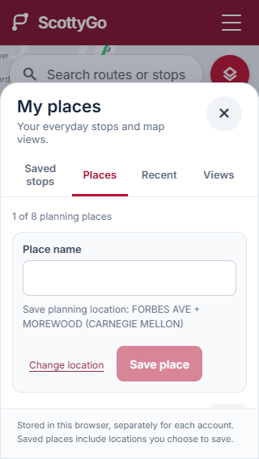

## iPhone rider release log — November 5, 2026

The use cases above are the starting checklist for these rounds. Browser checks use phone-sized WebKit and desktop Chrome. Controlled data covers missed buses, service failures and account writes without submitting test reports to riders.

Final acceptance on November 5 passed 101 Jest suites and 1,422 tests, including the isolated MongoDB workflows; 20 opt-in live-provider tests were skipped. Two additional focus-recovery regression tests passed after that full run. The cumulative browser walkthrough passed 18 interaction groups on iPhone-sized WebKit and desktop Chrome, backed by 674 alternate-path checks and 7 iOS host checks. Additional hosted checks used real routes, platforms, vehicles, alerts and walking instructions. These are browser and host tests, not a physical-iPhone certification. Per-round local evidence is under the ignored `private/rider-rehearsals/`; deployment identity is available from `/transit/health`.

| Round | Friction observed | Changes riders can use |
| --- | --- | --- |
| 1 · Choosing a route | The route picker found **61C** but returned no matches for **McKeesport**, even though the agency names the route MCKEESPORT-HOMESTEAD. A floating Nearby button could cover Cancel. | Read and search the published route name beside its ID; order the list by number or name; see the exact route ID before partial matches; open an exact or unique search result with the keyboard’s Go key; reopen a recent route directly in the picker. Filter actions also sit above the map shortcuts. |
| 2 · Walk to the boarding stop | The phone showed a three-minute walk beside departures two and eleven minutes away. The card gave no distance, turns or boarding margin, and its exit control measured 26 × 22 pixels. | See the walking distance. Expand the supplied turn instructions and distances. Compare each selected departure with the estimated walking arrival. Identify the platform by its stop number and Pittsburgh arrival time. Collapse the details to see the route, or exit with a 44-pixel button. |
| 3 · Pick the right object at a crowded stop | Tapping platform 7117 on the Google map offered seven choices. The six route rows showed IDs alone. The stop row omitted its public number. | Filter the tapped objects by bus, stop or route. Search the choices by name or number. Identify each platform by its public stop number. Read the published name alongside each route ID. Tap **Zoom in here** to enlarge the exact intersection. In phone WebKit, searching the seven real choices for McKeesport found 61C and filtering to stops revealed #7117. |
| 4 · Finding a particular bus | The 61C vehicle list showed eight buses with timestamps, and no way to find one by number or compare its position with the rider's start. | Search by bus or reported platform; read the reported stop name or public ID when available; compare straight-line distances from the start; sort by nearest position or newest GPS; show only recent GPS in the list without hiding delayed map markers. Reset restores the full list. An ordinary map refresh also preserves an open filter draft. |
| 5 · Wait for a departure | Tapping the first of two visits by bus 4001 selected both. A three-minute-old prediction still read **Due**. Checking the next bus across three routes meant paging through nine departures. | Select an individual visit even on a loop. Compare the next departure on each route. Limit the board to the next 15, 30 or 60 minutes. Show only selected departures, with a one-tap return to the full list. See when a refreshed estimate shifts by two minutes or more. Old estimates say **Estimate passed**. |
| 6 · Check a change before boarding | A relocated-stop notice offered a route link without a way to find the platform. The inbox let the rider choose severity but had no way to isolate future agency notices or reports about priority seating. | Open an affected platform on the map when the agency provides its stop number. Search notices by that number. Read the publication-window status and filter for current, upcoming, ended or undated notices. Read all window dates in Pittsburgh time. Select an agency effect such as a detour or a rider topic such as priority seating. |
| 7 · Plan without sharing GPS | With location blocked, the map suggested choosing a start without offering a button. A saved platform was missing from the starting-point menu. | Open the picker directly from the permission message. Start from CMU campus, the center of the map, or a saved platform (including nicknames). See the active planning origin when you reopen the picker, and dismiss it by touch or Escape. These choices work for walking and discovery; GPS-only reports still need an actual fix. |
| 8 · Compare boarding points | With eight nearby stops, the nearest showed an eighteen-minute wait. A six-minute bus at the sixth stop had no preview. Checking it meant leaving the list, and saved platforms could only be managed elsewhere. | Save or unsave directly on a nearby card. See a platform's compass direction from the search origin. Load five more arrival previews at a time. Order checked stops by the earliest departure after the estimated walk. Restrict discovery to platforms serving two or more routes. |
| 9 · Recognize the bus before boarding | The phone card showed Bus 4100 and Route 61C with Next stop #7117. Even Details omitted a street name, direction, absolute GPS time and distance. A real 61C sample had no agency stop or direction information. | Read the supplied travel direction and route name. Open the reported platform using its number and known name. Compare straight-line GPS distance to the measured bus position in Details. Read the GPS timestamp in Pittsburgh time. Switch reported speed between mph and km/h. Open the route map from Details. Missing agency fields stay unknown, and the extra measurements remain collapsed. |
| 10 · Read the map while riding | The layer button cycled through five modes without naming the next one, and reloading lost the selection. Satellite could not stay on while showing traffic. Search and discovery tools continued to cover the map when following a ride. | Select a named overlay directly. Combine it with streets or satellite imagery with street names. Increase street-text contrast. Keep appearance preferences across reloads in the same browser. Enter Focus on map, with an always-visible return to controls. Reset appearance in one tap. |

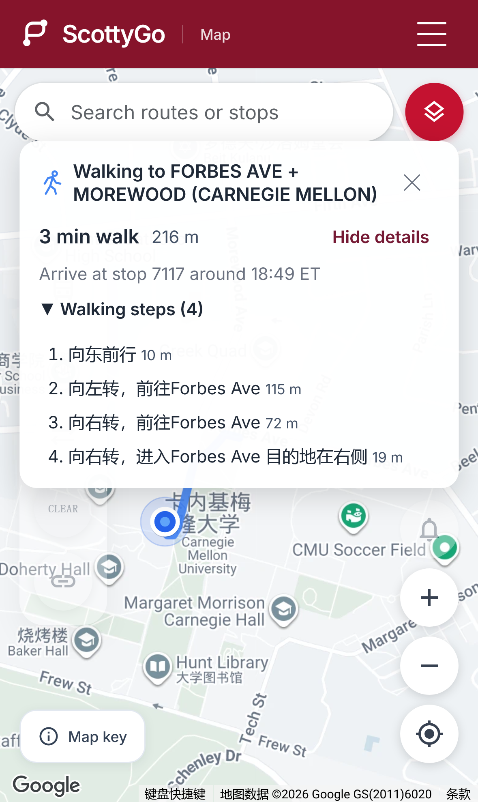

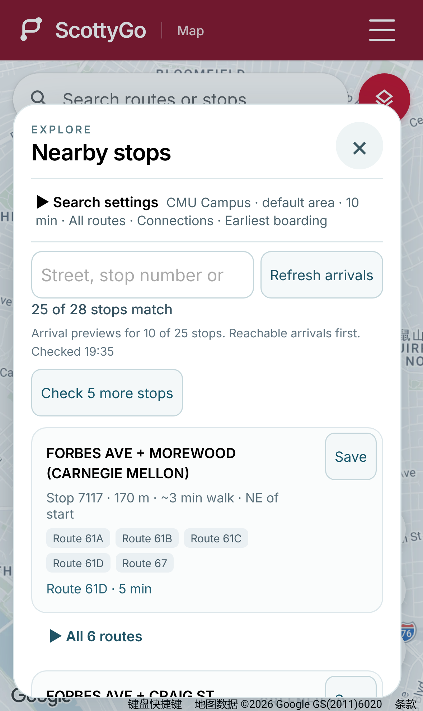

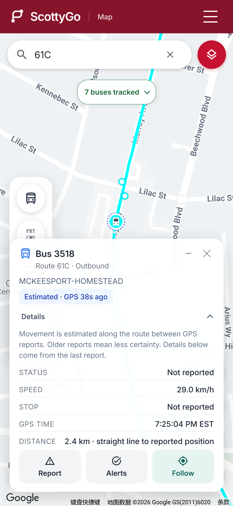

## Previous ten rider walkthroughs and fifty improvements

Each round started with a rider using the previous interface in a browser. The checks below describe how to try the five changes in the shared iPhone and web interface.

| Round and rider task | What happened during the walkthrough | Five changes to try |
| --- | --- | --- |
| 1. Find the right platform | Two Forbes/Craig results had the same name. Route 45 appeared by name alone. | ① Highlight the matched name or ID. ② See numeric route IDs beside names. ③ Compare straight-line distance from the planning origin when available. ④ Find exact stop or route IDs first. ⑤ Keep the chosen Routes or Stops scope while refining mixed results. |
| 2. Compare nearby stops | Two platforms were difficult to distinguish, only five of eight transfer routes were named, and settings took up the first screen. | ① Filter loaded stops by street, number or serving route. ② Identify platforms by stop ID. ③ Expand the complete serving-route list. ④ Refresh arrival previews and see when they were checked. ⑤ Collapse the search settings while keeping the area, range and scope visible. |
| 3. Plan a transfer on a route | Route stops appeared alphabetically. The list gave little help finding an interchange or a vehicle going the right way. | ① Sort stops by distance from the planning origin. ② Read known connecting routes at a stop. ③ Search stops by connecting route. ④ Filter the vehicle list by direction. ⑤ Read reported vehicle movement or detour status when the operator supplies it. |
| 4. Read relevant alerts | Marking a filtered inbox as read left an empty screen. It took several actions to get back. | ① Choose an exact affected route. ② Restrict agency alerts to warnings and severe notices. ③ See counts on the source tabs. ④ Clear the active filters together. ⑤ Undo the last batch marked read. |
| 5. Maintain saved routes | Muted routes were hard to find. The add sheet mixed operators and included routes already saved. | ① Read PRT route names. ② Filter saved routes by alert setting. ③ Sort by route number or most recent rider report. ④ Browse available routes by operator. ⑤ Hide routes already saved in the add sheet. |
| 6. Return to a familiar stop | Finding a stop meant scanning lists. Reopening My places returned to the first section. | ① Search saved stops by official name, nickname or stop ID. ② Put the nearest saved stops first when an origin is available. ③ Filter Recent to routes or stops. ④ Save a stop directly from Recent. ⑤ Reopen the section last used in the current session. |
| 7. Register on a phone | It was hard to see which field was blocking registration or check the account details before submitting. | ① Complete an Andrew campus email with one tap. ② See the remaining password rules while typing. ③ Jump to the next incomplete field. ④ Review the username and email together. ⑤ Read the terms and return to the form with its values intact. |
| 8. Find map help a second time | The introductory walkthrough went forward one screen at a time. Returning to an earlier topic was difficult. | ① Replay the tour from Map key. ② Jump to a named topic. ③ Go back one step. ④ See progress based on the controls currently visible. ⑤ Keep the guide in view on rotation and return focus to its opener when closing. |
| 9. Send a bus report deliberately | Skipping the comment at the end sent the earlier answers immediately in the test flow. | ① Jump to a report category. ② Identify and clear a selected answer. ③ Skip an answer without sending the report. ④ Review and edit answers before explicitly sending. ⑤ Choose how to handle a draft when closing. |
| 10. Choose a departure at a busy stop | The old card showed eight of fourteen supplied arrivals. The empty card at stop 7117 offered no immediate refresh. | ① Filter arrivals by route. ② Reveal later departures beyond the first eight. ③ Switch between countdowns and Pittsburgh clock time. ④ Refresh on demand and see the last successful check time. ⑤ Clear selected buses together, including selections hidden by a route filter. |

Phone-sized WebKit and desktop Chrome exercised all ten rounds with controlled data. The same fourteen-arrival fixture showed eight rows in the original card, then all fourteen on demand in the new card. A 61C inbox fixture went from three notices to two route matches to one warning, then zero unread and back to one after Undo. The report walkthrough checked the event at the submission boundary: Skip and Review sent nothing, and explicit submission sent one report to the test handler.

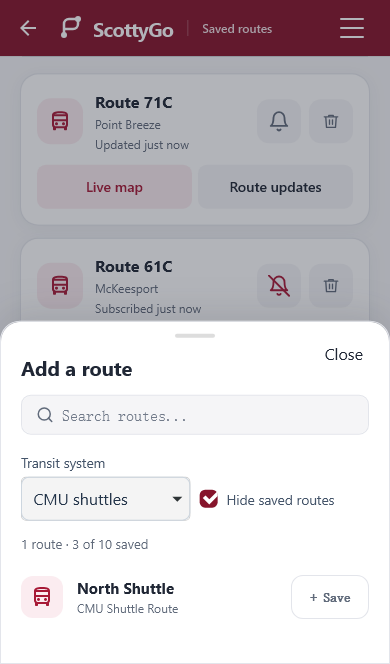

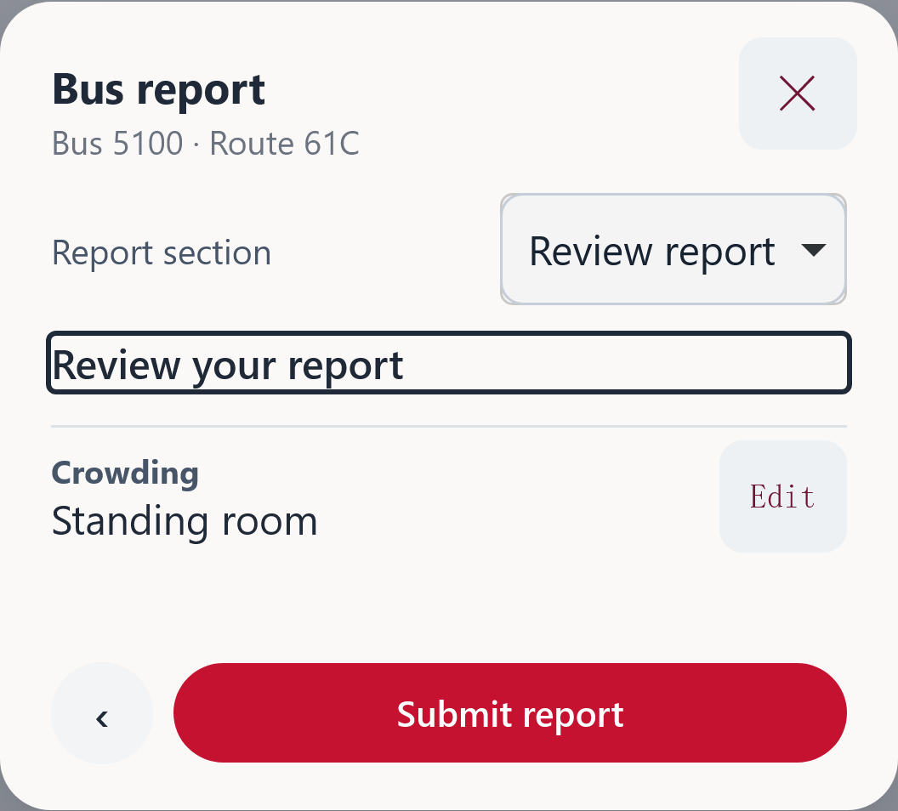

## iPhone and web rider improvements

The iPhone app loads the same ScottyGo pages as the browser. The first ten improvements below work on both. Personal settings stay in the browser or app where they were created.

| Round | What to try | Expected result |
| --- | --- | --- |
| 1. Check a password | Tap **Show** during sign-in or registration. | Verify the current field without retyping. Leaving the form or backgrounding the page conceals it again. |
| 2. Return to a stop | Open a stop or filtered route, visit Saved routes or Updates, then tap the ScottyGo map link. | The same tab restores that account’s last public map selection. |
| 3. Narrow a search | Search for a term that matches both routes and stops, then tap **Stops**. | Only matching stops remain. Switch back to **All** without typing or fetching again. |
| 4. Decide which bus to walk for | Open **Nearby stops** and compare the walk with the first arrival. | If it may leave before you get there, the row shows a later listed option when available. Walking and arrival times are estimates. |
| 5. Browse a route | Switch between **Stops** and **Buses** in the route explorer. | Jump directly to either list. The stop search stays in place when you come back. |
| 6. Recover arrivals | Keep a stop open while the connection drops, then reconnect or tap **Retry arrivals**. | Last-known arrivals display clock times. A successful empty response shows **No upcoming arrivals**. |
| 7. Share a stop or view | Tap **Share stop** or the map’s share button. | Supported devices open the system share sheet. Other browsers offer a copyable link; canceling the sheet leaves the clipboard alone. |
| 8. Name a daily stop | Under **My places → Saved stops**, open **More** and add a nickname. | The official stop stays visible. Opening and sharing still use its original stop ID. |
| 9. Open a saved route | Choose the map or updates link on a saved-route card. | Open that route directly on the map, including the CMU system where needed, or read its alerts. |
| 10. Catch up on alerts | Filter the inbox, then mark the shown updates as read. | The action applies to the current results. Other routes and future updates keep their own read state. |
| 11. Return after iOS frees memory | Return to the iPhone app after WebKit discards its page. | The app tries to reload the page on return; a repeated failure within a minute offers a manual retry. |

Browser acceptance used the actual built UI with controlled transit responses. In phone-sized WebKit and desktop Chrome, filtering mixed search results used a single request; a six-minute walk surfaced the nine-minute arrival after a two-minute arrival; and switching route tabs retained the stop search. Both browsers restored the public route and stop after visiting Alerts and recovered a stop card from a failed prediction request. At 375 px, the WebKit checks also verified filtered read marks after reload, separate map and alert destinations for a CMU route, and adding, reopening and removing a nickname. The iOS package has separate tests for foreground recovery and repeated termination.

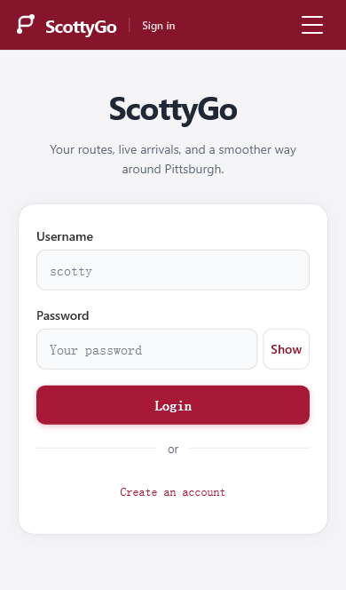

On the personal Render deployment, phone-sized WebKit opened stop 7117, returned to that stop from Alerts, and switched between the real 61C stop and vehicle lists. At the time of capture the route showed eight vehicles. Counts change with service.

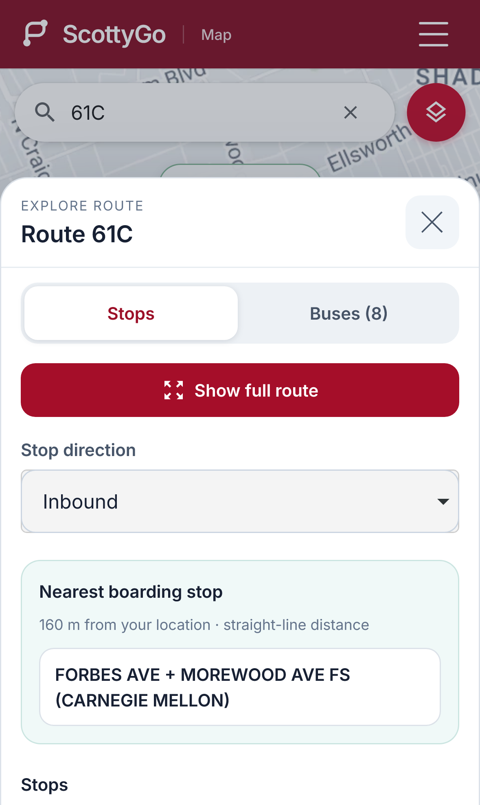

## Realtime bus movement refinement

The map keeps one marker per bus and updates its position between agency reports. This iteration improves how fresh reports reach the browser and how the marker reconciles them:

- Shared PRT and CMU feeds refresh every 15 seconds. The visible map reads cached positions every 5 seconds, with feed health included in the same response. Failed upstream requests back off and honor `Retry-After`.
- When a live trip cannot be matched safely to the static schedule, the bus keeps its measured route and position. Prediction can follow a locally unambiguous path or the shared section of plausible route variants, then waits before their paths diverge.
- An isolated impossible GPS jump is quarantined. A second distinct, consistent measurement can confirm a relocation. Repeated or older measurements retain their original position and source timestamp.
- Small overshoots on a moving route converge by slowing the marker instead of sending it backwards. Significant corrections slide along the route and briefly show **Updating position** in the selected bus card.
- Low-speed traffic and frequent source updates use cadence-aware motion evidence. Repeated confirmed stops suppress GPS wobble; fresh timestamps with unchanged coordinates eventually stop prediction even if a speed value is stuck.
- Route metadata refreshes and reselecting the same route preserve usable motion history. Returning from a hidden tab starts from the last painted point. The heading arrow turns smoothly through the shortest angle and remains steady at rest.
- A prediction that exhausts its evidence shows **Waiting for GPS**. Actual stop reports, route terminals, outages, reduced-motion preferences and bounded prediction horizons remain respected.

The selected approach is a lightweight route-constrained estimator with robust observation filtering and adaptive reconciliation, computed in the browser. Offline-trained models were considered; the project currently has no labelled high-frequency ground-truth trajectory set with which to establish that one would predict more accurately. Agency measurement age remains visible in Details, and all proximity/reporting checks continue to use measured coordinates.

Production checks exposed a provider-data mismatch: at 17:33 UTC on October 24, 2026, the public static feed and 143 live bus records had no matching trip-and-route pairs; 32 live trip IDs referred to other static routes, and 111 were absent. For example, two live 61C buses inherited static 28X and 13 metadata. The API now rejects those cross-route associations, and shared-path prediction handles missing exact trip geometry. The [official PRT developer page](https://rideprt.org/business-resources/web-developer-resources/) linked the same static archive tested in this audit.

### Realtime acceptance

Use cases cover a continuously moving bus with delayed reports, slow traffic with GPS noise, an isolated bad coordinate and recovery, a measured stop and departure, route bends, duplicate/out-of-order data, missing geometry, background return, and refreshed route metadata. The deterministic comparison runs with `node tools/vehicle-motion-replay.mjs --baseline 17a0421`.

| Controlled replay | Previous version | Refined version |
| --- | --- | --- |
| Low-speed noisy traffic: backwards travel over 120 seconds | 81.30 m | 11.30 m |
| Low-speed noisy traffic: frozen display while truth moves | 56.40 s | 9.40 s |
| Low-speed noisy traffic: mean position error | 10.38 m | 4.21 m |
| Isolated impossible fix: largest movement in a 50 ms frame | 1,472.40 m | 3.37 m |
| Missing route geometry: largest movement in a 50 ms frame | 160.00 m | 3.75 m |

These are synthetic regression measurements with known trajectories, not measured accuracy of real buses. Sliding without known geometry adds about 10 m to mean lag in that scenario while removing the abrupt jump. A reported zero speed still takes effect immediately in the model, and an outage eventually holds the marker instead of inventing indefinite travel.

Local acceptance passed the full regression suite (1,357 tests, 20 opt-in tests skipped), including tracker, static/live route compatibility and shared-corridor safeguards. Eleven replay scenarios and 32 replay/safety tests cover the motion behavior. A 390 × 760 browser fixture using the real map provider and production tracker verified continuous movement, one-marker retention through an injected 1.7 km outlier, measured stop/restart, same-route selection, provider outage, and 95–105-second delayed reports. This is desktop browser emulation; physical iPhone validation remains separate.

## Five-iteration rider experience release

All 25 additions below are implemented and accepted through automated behavior tests and local browser checks. Each round contains five independently usable features. Release commits are recorded below; production deployment is verified separately.

| Round | Rider goal and features | Acceptance target | Local acceptance |
| --- | --- | --- | --- |
| 1 — Read and select the map | Unified bus/stop/route overlap chooser; shared-stop deduplication; zoom-aware stop density; route emphasis; selected-stop halo | Every overlapping object can be selected; hidden objects are excluded; the same stop is drawn once; selected context stays visible. | Accepted, 5/5 |
| 2 — Find a place to board | Nearby stop list; search the map area; 5/10/15-minute walking range; current-route filter; next-arrival comparison | Distance-sorted stops respect range and route; area search preserves GPS; independent prediction failures remain recoverable. | Accepted, 5/5 |
| 3 — Explore a route | Route stop browser; current-bus list; nearest boarding stop; explicit bus follow mode; full-route overview | Direction and search work together; lists open the right map object; dragging pauses follow; overview respects visible geometry. | Accepted, 5/5 |
| 4 — Repeat a journey | Saved stops; named planning places; recently viewed routes/stops; named filter presets; share a stop | Browser-local items survive reload, are account-scoped, and reopen current data; shared stop links survive sign-in. | Accepted, 5/5 |
| 5 — Read relevant updates | Saved-route alert scope; read/unread tracking; priority/newest sorting; route grouping; share update summaries | Filters compose without losing updates; changed notices become unread again; shared text contains safe public links only. | Accepted, 5/5 |

### Round 1 — accepted

Shared stops now use one marker with all serving routes; below zoom 14, ordinary stop dots hide while a selected stop retains its halo. Route strokes adapt to zoom and the selected route receives stronger emphasis. Tapping a crowded map point opens **Choose on map**, with separate bus, stop, and route groups. The chooser uses a consistent 24-pixel radius at every zoom and excludes hidden or removed objects.

Acceptance: 547 client tests passed (45 suites), plus lint, TypeScript and production build. A fixed CMU browser fixture at 390 × 760 verified two overlapping buses, one shared stop and two routes; selecting the stop/route invokes the correct action, overview hides ordinary dots, and highlighting retains the stop. Live-map phone acceptance and deployment evidence are recorded with the release commit.

### Round 2 — accepted

**Near me** opens a distance-sorted stop list. Choose an approximate 5, 10 or 15-minute walking range, search the current map center, or return to the current/planned starting point. When a route is selected, switch between that route and all routes. The nearest five stops compare their next arrivals, refreshing every 30 seconds while the panel is visible. Failed predictions remain distinct from a valid empty response; tap any stop to open its full arrival card.

Acceptance: 16 new behavior tests cover range filtering, sorting, cancellation, route scope, independent prediction failures and bounded concurrency. Browser checks at 390 × 760 returned 28 stops for 10 minutes, 3 for 5 minutes, and 2 after filtering to 61C. Area search changed the query center; the original starting point remained available. A stop-row selection centered the map and opened stop 7117. No upcoming arrivals were supplied in this live overnight sample; populated arrivals are covered by deterministic tests.

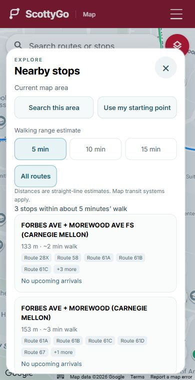

### Round 3 — accepted

**Explore route** provides a direction-specific stop browser, a nearest boarding stop from the current planning origin, a list of buses shown by the map filters, and **Show full route**. Stops are searchable and displayed alphabetically; the API does not provide a verified trip stop sequence. Selecting a list item centers its map object. A chosen stop remains marked even outside the current route layer.

The bus card's **Follow** action keeps the displayed bus position centered at most once per second. Dragging pauses it; **Resume follow** explicitly starts it again. Closing/minimizing the card, selecting a different map target, entering directions, or hiding the bus stops follow mode. It follows the same reported/estimated marker and does not change GPS freshness.

Acceptance: route explorer, vehicle tracker, renderer and provider tests cover cancellation, hidden-direction behavior, stopped follow state, stale selection, and viewport fitting. Phone browser checks used route 61C and bus 3518: switching to Outbound retained the Morewood search and returned stop 7117; list selection opened that bus; Follow → drag → Resume → Stop worked; route overview changed zoom 17 to 11. The selected-stop lifecycle also covers a platform outside the visible layers.

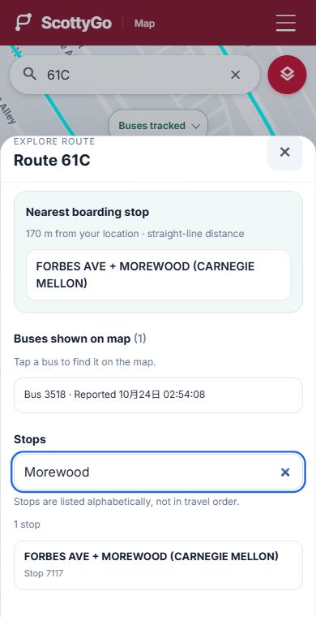

### Round 4 — accepted

**My places** brings four compact sections to the map: **Saved stops**, **Places**, **Recent**, and **Views**. Stop cards offer **Save stop / Saved** and **Share stop** alongside directions. Open a saved stop to resolve its current transit record and arrivals. Saved places reuse a named planning origin; saved views restore route, transit-system and direction filters. Recent routes and stops provide a quick way back to an earlier selection.

| Shortcut | Limit and behavior |
| --- | --- |
| Saved stops | 20 stops; open, share, or remove them. The card and saved list reflect the same state. |
| Planning places | 8 named locations; save the current planning origin, reuse it, rename it, or remove it. |
| Recent | The latest 8 distinct route/stop selections; reopen an item, remove it, or clear the list. |
| Views | 8 named filter presets; save, apply, rename, or remove them. GPS, account credentials, and schedule dates/times are excluded. |
| Share stop | A public `#/map?stop=...` link containing only the stop ID. It survives sign-in and supports a manual-copy fallback. |

Shortcuts stay in this browser and are separated by immutable account ID. Changing a username preserves them; a different account does not inherit them. Named places contain locations the rider explicitly saves. Corrupt stored entries are discarded, and blocked storage retains changes for the current page session. Background history updates preserve a place-name or rename draft, its caret, and keyboard focus.

Phone browser acceptance verified saving and applying a named CMU campus place, saving a **61C commute** view, reloading, clearing the route filter, and restoring that view. Stop **4407** was saved and shared; the local preview copied exactly `http://127.0.0.1:8180/#/map?stop=4407`, with no rider location or account data. Reload reopened that stop at zoom 16 and retained its map center despite an older saved planning origin. Recent reopening passed for stop 4407 and routes 61A/61C; the selected route and current stop card were restored correctly. Automated checks cover account isolation, bounded storage, draft preservation, cancelled/stale stop lookups, retry, and minimized-card restoration.

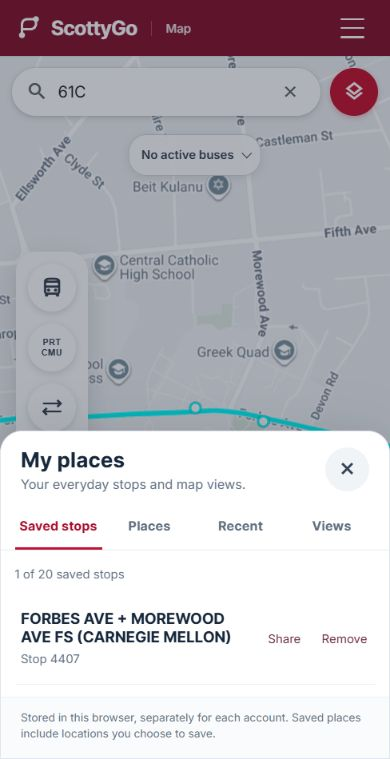

### Round 5 — accepted

**Saved routes** narrows updates to followed routes; **Unread** shows items still to read. Each card has an explicit **Mark read / Mark unread** action. Read state survives reload in the same browser and account, and an edited notice becomes unread again. These controls combine with search and All updates / Service alerts / Live updates.

**More options** contains **Priority first / Newest first** ordering and route grouping. Priority uses the agency's supplied severity. Newest uses a rider report's creation time or an agency alert's latest supplied active-period start. A notice affecting several routes appears once, under its route combination; in Saved routes mode, followed routes lead the group heading. **Share** opens the device share sheet or copies a brief public summary, with visible confirmation and a manual-copy fallback.

Local browser acceptance used 14 real agency notices. Searching **Forbes** returned one; marking it read and enabling Unread returned zero. Reloading the full list showed **14 updates · 13 unread**. After following 61C, Saved routes showed one matching notice; grouping placed 61C first in its heading and kept a single card. Share copied its public title, routes, description and agency URL, then displayed **Update summary copied.** At 390 × 760 and 320 × 568, the page had no horizontal overflow. The short-screen map key also moves clear of the left toolbar. Automated tests additionally cover changed-content fingerprints, account separation, corrupt/expired storage, combined filters, sorting, deduplication, refresh focus, safe links, share cancellation and clipboard fallback.

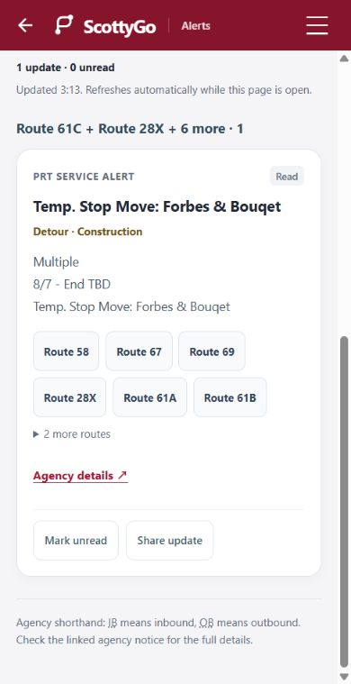

### Release commits

| Round | Pushed commit |
| --- | --- |
| 1 — Map clarity and selection | `53998fd` |
| 2 — Nearby boarding | `52355a3` |
| 3 — Route exploration and follow | `19d8f84` |
| 4 — Journey shortcuts | `c9f20c9` |
| 5 — Personal alert inbox | [rider-ux-2026-10-24](https://github.com/Naihe0/s26-fse-scottygo/tree/rider-ux-2026-10-24) |

Final local verification: **1,289 tests passed across 90 suites**, with 20 opt-in tests skipped. ESLint, all three TypeScript configurations, the production build, Windows path validation, and the production dependency audit passed; the audit reported zero vulnerabilities. Browser acceptance covered 320 × 568, 390 × 760 and 1440 × 900 viewports. Each of the first four production rounds passed 15 post-deployment checks covering pages/assets, transit feeds, route catalogs, Atlas persistence, authentication and Maps configuration.

## Map and route discovery

After signing in, the map starts near your location when permission is available, or near CMU campus otherwise. Search by route number, route name, stop name, or stop ID. Selecting a result opens that route or stop without requiring you to find it manually on the map.

### Finding and filtering with fewer interruptions

- Search immediately shows a loading state while a short typing pause groups requests. New input cancels an older request; clearing or closing the list prevents late results from reopening it. Failed searches offer a **Try again** action, and empty results suggest another route number or stop name.
- Results distinguish **Routes** and **Stops**. Use Up/Down and Enter to select while focus stays in the input, or tap a result to close the phone keyboard. Escape closes the results. Composing text with an input method does not submit partial characters.
- The route picker keeps its search input stable as results change. The selection remains visible in a summary; choose **All routes** to remove the route filter, then apply the draft. A search with no matches includes a clear-search action.
- System and direction panels have descriptive headings, full-row toggles, and explicit **Apply** and **Cancel** actions. Closing or pressing Escape cancels the draft and restores the opening control. An empty selection explains what will disappear; loop shuttles remain visible when both directional filters are off.
- Filter inputs use phone-safe text sizes and controls have generous touch targets. Panels stay within the available viewport, with scrollable content and reachable actions.

These interactions cover the main rider flows: find a route or stop, refine the map, revise a draft without losing the current view, and recover from a failed request in place.

| Control or action | What it does |
| --- | --- |
| Route filter | Choose a route and inspect its operating days, first/last trips, directions, alerts, and available detours. |
| PRT / CMU filter | Show either transit system or both. PRT is the default. |
| Direction filter | Show inbound, outbound, or both. CMU loop services may have only one available direction. |
| Shared schedule filters | A shared map URL can carry date/time filters for scheduled service; the current map toolbar exposes route, system, and direction controls. Schedule filters do not simulate future bus positions. |
| Route paths and stops | View colored route geometry, direction cues, stop markers, and available detour overlays. Selected routes receive stronger emphasis. |
| Zoom and recenter | Adjust the view or return to a close view around your location, approximately a 200-meter radius where the viewport allows it. |
| Map key | Explain route, stop, bus, estimated-position, delayed-position, and personal-location symbols. |
| Clear all filters | Restore default route/date/time/system/direction filters and close their panels. A chosen planning location is preserved. |
| Copy view link | Share the current route and filters. Coordinates, planned locations, query strings, and account tokens are excluded. A manual-copy dialog appears if clipboard access fails. |
| My places | Open saved stops, named planning places, recent selections, and saved map-filter views. |
| Share stop | Copy a link to one public stop; the receiving browser resolves the current record before opening its card. |
| Browser Back / Forward | Restore the previous route/filter or shared-stop view. Shared views and stop links also survive the sign-in flow. |

### Current desktop map

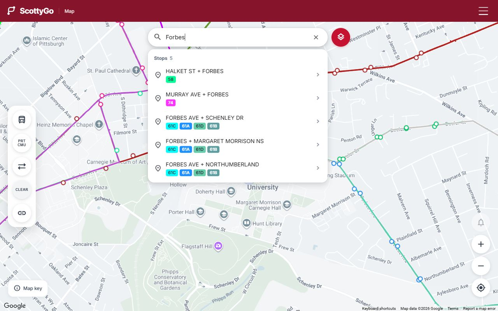

### Current phone layout

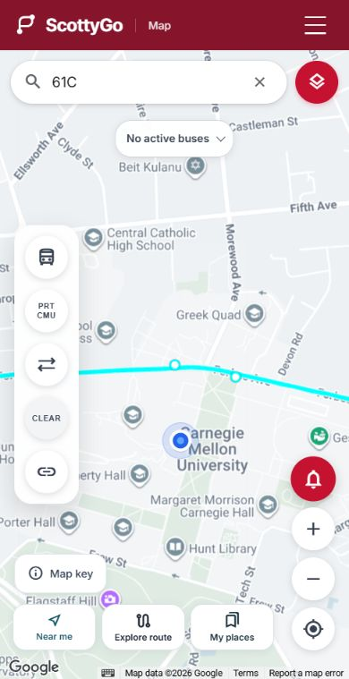

The screenshots are captures of the current app in a local preview, replacing the historical design mockups. The location is a fixed CMU demonstration point, not a user's personal location. Bus data and agency notices come from public feeds and are snapshots rather than fixed examples.

## Map appearance

The layers button opens **Map appearance**. Choose the base and overlay separately; both choices preserve ScottyGo buses, platforms and route selection. Satellite includes street names. **Stronger street labels** increases road-map text contrast. These display preferences stay in the same browser; private browsing or blocked storage falls back to the current session. **Focus on map** temporarily hides search, filters and discovery tools, retaining transit markers, zoom, GPS and the **Show map controls** button. Escape also restores the controls. Opening the starting-point picker, a route explorer or a report dialog restores the tools automatically without taking keyboard focus away from that flow. **Reset appearance** returns to streets with no extra overlay.

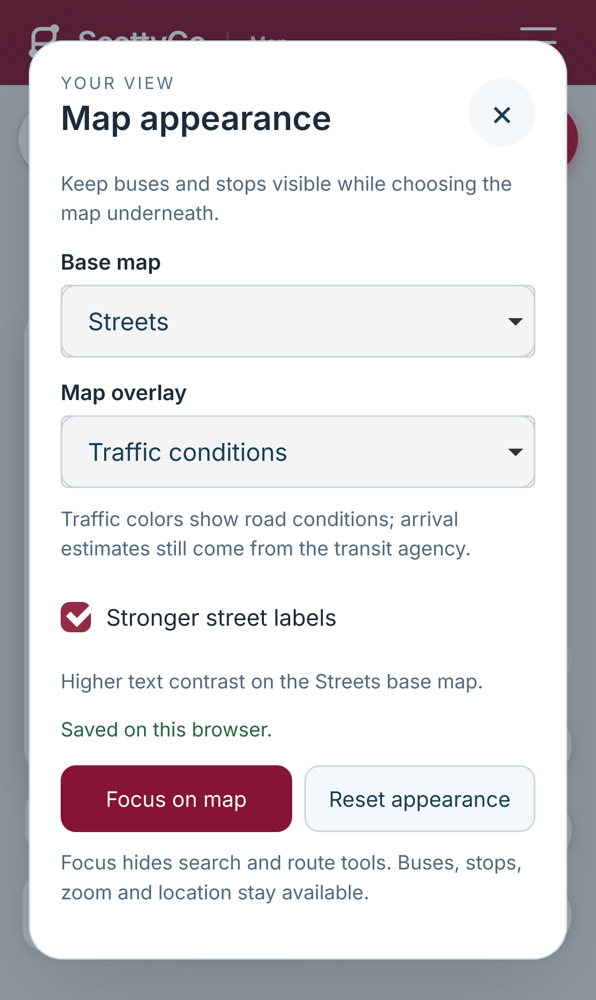

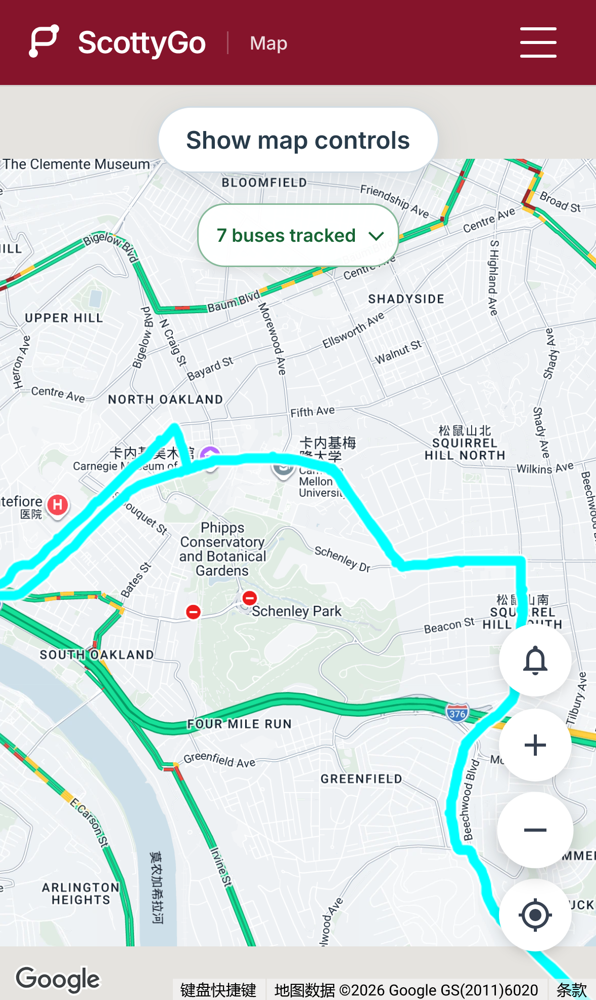

## Live buses and movement

Each bus has **one circular marker**, containing a bus symbol, with a triangle indicating its heading when known. Tapping it centers and zooms the map to that bus. Its compact card identifies the route/bus and the position state, with **Report** and **Alerts** actions immediately available. Expand **Details** for additional tracking information. The map's tracking banner provides a brief status; tap it to see more information. Keyboard users can open either disclosure and close it with Escape.

Between actual GPS reports, the marker estimates motion along the known route. It uses the trip's shape when available, observed route progress, heading, speed, and stop information. Eligible moving buses continue updating between network refreshes, including when the latest report is already delayed on arrival. New actual reports correct the **same marker** by sliding it toward the updated position. No separate predicted or actual marker is drawn.

Reported, estimated, and delayed states remain distinguishable. A delayed position can remain visible for up to 15 minutes; an authoritative healthy feed can remove a bus that is no longer present. Predicted movement slows near mapped stops, and a reported next stop can trigger a brief dwell before departure. Explicit stopped/zero-speed observations hold position. Prediction also stops when evidence is too weak, a terminal is reached, or its time/distance bounds are exhausted. A provider outage pauses the marker where it is until a distinct report arrives. Animation honors reduced-motion preferences and pauses in hidden tabs.

The moving icon is an estimate, not a new GPS measurement. It does not change the source report time, arrival predictions, or the real coordinates used to check whether a rider is near a bus.

### Selected bus and details

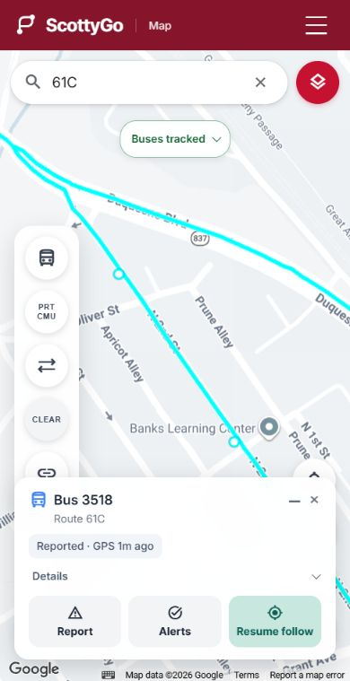

## Stops, arrivals, and walking

Select a stop to see the serving routes, upcoming arrivals, delay indicators, and estimated walking time when a starting location is available. Predictions refresh while the stop card remains open. Empty results and unavailable data have separate messages; a scheduled route is not a promise that a live bus or arrival estimate currently exists.

**Save stop** keeps the stop in My places; **Saved** removes it when tapped again. **Share stop** copies a public stop link. These controls remain usable after minimizing and restoring the card, including when a previous copy operation was still pending.

Nearby-stop discovery uses the current or planned starting point and respects the selected filters. A rider can choose **Set a different location** through Places search, then return to **Current Location** later. A planned point helps with route discovery and walking directions, but does not grant GPS access or establish proximity for a bus report.

Directions shows the walking path, distance, duration and estimated arrival at the numbered stop in Pittsburgh time. Open **Walking steps** to see the directions supplied for that path. Selected departures from an available prediction feed show the estimated time left after the walk. When that feed pauses, last-known departures keep their Pittsburgh clock times and give no boarding-margin claim; expired estimates say **Estimate passed**. **Hide details** leaves distance, duration and any route warnings visible. GPS updates support progress and rerouting. Loading can be cancelled; failed requests time out and restore the map rather than leaving it locked. Exiting directions restores the latest selected map filters.

## Location access and recovery

Your location uses a distinct high-contrast marker and accuracy treatment. Recenter explicitly requests a closer view; ordinary GPS updates do not repeatedly take over your chosen zoom or interrupt a selected stop or active directions.

Location feedback distinguishes blocked permission, timeout, unavailable position, and unsupported browser. The map remains usable. **Try again** restarts location acquisition; the blocked-permission message offers expandable settings help. Browser-level permission and the device's location permission both need to allow access. A successful retry clears the feedback and restores location-dependent actions. The app cannot override a device setting itself.

On phones, controls and sheets use the available viewport and safe-area spacing. Keyboard focus, touch targets, wrapping text, and reduced motion are supported. Desktop browser tests at phone dimensions do not replace acceptance on a physical iPhone.

## Alerts and rider updates

The **Notifications** page offers **All updates**, **Service alerts**, and **Live updates**. Search remains within the selected view. Service alerts come from PRT; live updates are rider reports from the last 30 minutes.

- Agency cards identify affected routes and show supplied effect, cause, severity, and notice dates when available. Missing metadata is not invented. Long descriptions and large route lists expand on demand.
- Explicit HTTP(S) links in agency text and rider comments are clickable. Unsafe link schemes and embedded markup are not executed. Agency-source links open separately; route chips open the affected route on the map.
- Rider cards identify the bus, route, reported changes, and age. They remain distinct from agency alerts. Relative time is accompanied by an accessible absolute timestamp.
- Saved routes and Unread filters combine with the update type and search. Mark read or unread explicitly; read state is local to this browser and account. Changed notices become unread again.
- More options controls priority/newest ordering and route grouping. Multi-route notices keep one card and one count. Share provides a short public summary through the device share sheet, clipboard, or manual copy.
- Refresh, foreground polling, and live events update results without clearing the search or expanded details. If one source fails, successful data remains visible with a source-specific message.
- Foreground popups link to the route and update history. They are bounded and deduplicated, pause dismissal while being read or focused, and can be dismissed directly.

### Current alert center

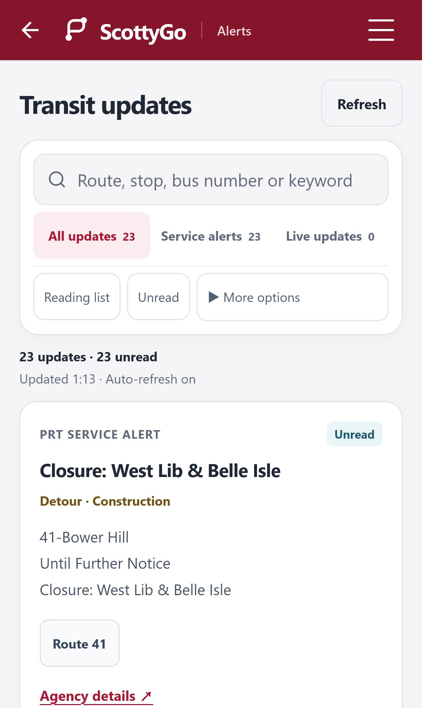

Notifications appear inside the open website or iPhone app. Lock-screen push notifications and offline maps are not available.

## Saved routes and reports

The **Subscriptions** page saves up to **10 routes per account**. Add a PRT or CMU route, open its map, remove it, or mute its foreground popups. Saved routes persist on the server. Mute choices are stored in this browser and do not remove the saved route.

The add-route sheet marks successful additions as **Saved**, preserving the current search, scroll position, and focus. Removal uses the explicit action on a saved-route card. Loading, no saved routes, no search matches, and request failure have distinct messages; failed loads can be retried in place. A failed save keeps the route available to try again.

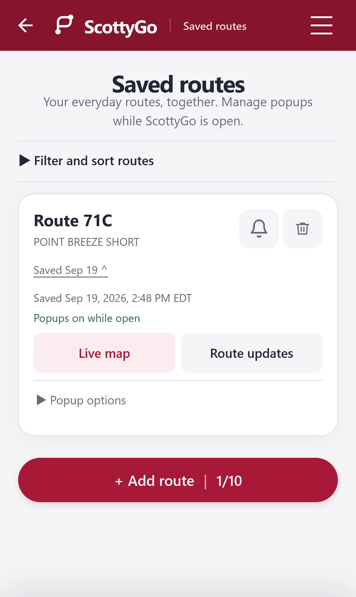

To report bus conditions, select a bus and open its report action. Choose any combination of crowdedness, priority-seat availability, vehicle condition, and an optional comment of up to 200 characters. At least one answer is required. The normal proximity limit is half a mile from the bus's reported location; the browser also requires usable GPS and a recent bus report. Delayed or predicted display coordinates never substitute for measured proximity. Administrators have a server-side proximity exemption, but still use the browser's location/freshness safeguards.

Changed conditions create a live route update. An identical condition report does not create another notification. Comments pass moderation; a flagged comment can be omitted while valid condition answers are accepted. The submission result explains that outcome.

## Accounts and navigation

Registration requires a unique username, a CMU email address, a valid password, and the terms flow. Inline validation explains invalid fields. Sign in, sign out, page navigation, a first-use map tour, and account editing are available from the app shell.

Short feedback uses one dismissible message at a time, with a timeout that pauses while hovered or focused. Map message dialogs move focus to their confirmation button, keep background controls inactive, and return focus when closed with OK or Escape.

| Role / state | Available account actions |
| --- | --- |
| Member or Coordinator | View and edit their own username, CMU email, and password; deactivate their own account. Coordinator currently has the same account-management scope as Member. |
| Administrator | Search/select users, edit accounts, change Active/Inactive status, and assign Member, Coordinator, or Administrator privilege. |
| Inactive account | Cannot authenticate or keep using an active session; an administrator must reactivate it. |

The last active administrator cannot be removed through deactivation or demotion. Password changes revoke previous sessions; account changes are reflected in connected views. Optional account-status emails are sent only when the deployment has email configured. Changing a username preserves the immutable account identity and saved routes.

## Operational visibility and limitations

The [memory dashboard](https://scottygo-ningrui.onrender.com/transit/memory/dashboard) shows process memory, historical samples, peak context, and CSV export. It complements the transit health endpoint described in [API.md](API.md).

Live transit and directions depend on their upstream services and the network. Startup can temporarily show no route data while GTFS and caches load. The app distinguishes readiness, delayed measurements, provider failure, and valid empty results where those signals are available. A Free Render service can sleep; the foreground app cannot guarantee continuous background delivery while its server is asleep.
